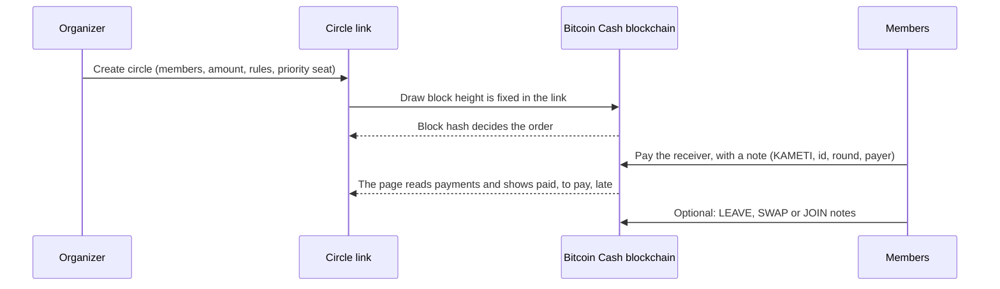
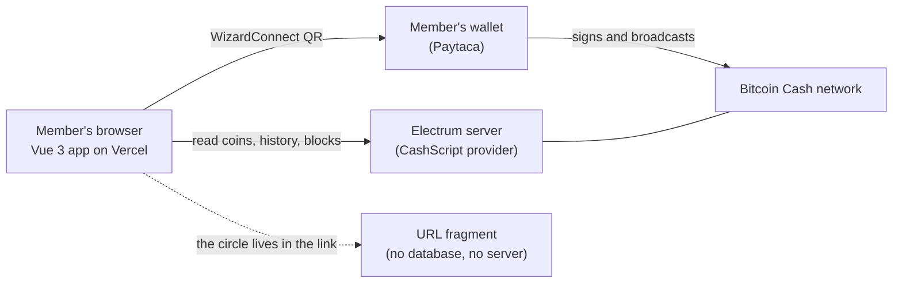

<div align="center">


<br>

### A kameti where nobody holds the money.

Interest-free savings circles on Bitcoin Cash. **No custody. No fees. Public proof.**


[**Live app**](https://kameti-blaze.vercel.app/) &nbsp;|&nbsp; [**Presentation**]https://docs.google.com/presentation/d/e/2PACX-1vTQPk0gK9Wt-nagJSo32PGx99MJep03qac_Ud8aZ762TVMWKbAc6e9Q_9Rndwi2Ih5EkyjRu5dfdLVM/pub?start=false&loop=false&delayms=3000) &nbsp;|&nbsp; [**Video**](VIDEO_URL_HERE) &nbsp;|&nbsp; [**Example circle**](https://kameti-blaze.vercel.app/#eyJuYW1lIjoia2hhbidzIHNhdmluZyBjaXJjbGUiLCJtZW1iZXJzIjpbeyJuYW1lIjoiSGFqcmEiLCJhZGRyZXNzIjoiYml0Y29pbmNhc2g6cXpkcTAyeDg5Z2p5cmc1OGozbXo0anI3cjZyNnV6bG5hZ2Ewc2R5bDNyIn0seyJuYW1lIjoiQWxpIiwiYWRkcmVzcyI6ImJpdGNvaW5jYXNoOnFyczJrZ2s1a2tmNGE3MGZ3ZTltc2hxZHZ5cTl2eGFqeWd0eHV5M3VzZyJ9LHsibmFtZSI6IlNhcmEiLCJhZGRyZXNzIjoiYml0Y29pbmNhc2g6cXJtNXR1MDN0eWNqdm44ZWNuMnY3bGQ1cDlyY2xyY3hnZ25rYW1jOTdzIn1dLCJhbW91bnRTYXRzIjoxMDAwMCwic3RhcnREYXRlIjoiMjAyNi0xMS0xNyIsImV2ZXJ5IjoxLCJ1bml0IjoibW9udGhzIiwicGF5V2luZG93Ijo3LCJkcmF3SGVpZ2h0Ijo5Nzc3NTksImRlbW8iOnRydWUsImZpcnN0IjowLCJhZ3JlZW1lbnQiOnsicnVsZXMiOlsiaGVpciIsImtub3ciLCJsYXRlIiwibm9pbnRlcmVzdCIsIm5vc2VsbCIsIm5vdGlmeSJdfX0=)

</div>

---

> [!IMPORTANT]
> **Pre-existing work is declared.** This project was started on **20 Oct 2026**, before the hackathon (14 Nov 2026). The old repository, its demo and the boundary in the history are listed [below](#pre-existing-work-declared).

## Contents

- 🧭 [At a glance](#at-a-glance)
- 📜 [Pre-existing work declared](#pre-existing-work-declared)
- 😟 [The problem](#the-problem)
- 💡 [The solution](#the-solution)
- 🔁 [How it works](#how-it-works)
- ✨ [Features](#features)
- 🪙 [Bitcoin Cash usage](#bitcoin-cash-usage)
- 🏗️ [Architecture](#architecture)
- 🎲 [The draw](#the-draw)
- 🔀 [Seat changes](#seat-changes)
- 📝 [Group agreement](#group-agreement)
- 🔐 [Security](#security)
- ⚠️ [Honest limits](#honest-limits)
- 🕌 [Design principles](#design-principles)
- 🧰 [Tech stack and structure](#tech-stack-and-structure)
- 🚀 [Run it locally](#run-it-locally)
- ✅ [Mainnet proof](#mainnet-proof)
- 🗺️ [Roadmap](#roadmap)

---

## At a glance

| | |
|---|---|
| **What** | A savings circle (kameti, committee, chama) where members pay the round's receiver directly |
| **Who it is for** | Groups who already know each other: families, friends, colleagues, neighbours |
| **Network** | Bitcoin Cash **mainnet**, real payments |
| **Wallet** | **WizardConnect** (tested with Paytaca) |
| **Backend** | None. No server, no database, no accounts: the circle lives in its link |
| **Order** | A future block hash decides the order, or a priority seat for an urgent need |

### How it maps to the judging criteria

| Criterion | What Kameti.cash offers |
|---|---|
| 💡 **Innovation and creativity** | A familiar real-world money habit moved onto BCH: a block-hash draw, a priority seat for urgent need, an on-chain group agreement |
| 🎨 **Design and usability** | A 3-step create flow, plain-language screens, identity card ("Connected as Sara"), round cards with named chips, works on phones |
| 🛠️ **Technical strength** | Real mainnet payments signed in the user's wallet, `OP_RETURN` notes for tracking and seat changes, block-header draw, a fully validated share link, no secrets in the app |
| 💰 **Business potential** | A very large existing market (kameti, chama, susu, tanda). Interest-free by design. Paths to explore: wallet and community partnerships, tools for organisations that run many circles, stablecoin circles |

---

## Pre-existing work declared

| | Link |
|---|---|
| 📦 Old repository (frozen on 13 Nov 2026) | https://github.com/Hajrajadoon/kameti-v1 |
| 🌐 Demo from before the hackathon | https://kameti-v1.vercel.app/ |
| 📦 New repository (this one) | https://github.com/Hajrajadoon/kameti-blaze |
| 🏷️ Boundary in the git history | tags `pre-hackathon-v1` and `pre-hackathon-final` |

This repository was created by cloning the old one, so **its history includes every earlier commit**. Commits dated **14 Nov 2026 or later are new work**.

<details>
<summary><b>Built before the hackathon (20 Oct to 13 Nov)</b>: the core logic and a plain first interface</summary>

- Create a circle: members, amount, period (days, weeks, months), first-week payment window
- Priority seat, and a payout order drawn from a future block hash
- WizardConnect connection and the wallet guard ("you are connected as ...")
- Real mainnet payments signed in the user's wallet, with an on-chain note, and payment tracking from the blockchain
- Leave, swap and join through on-chain notes
- Reminders, a calendar file and a balance check

</details>

<details open>
<summary><b>New during the hackathon (14 Nov onward)</b></summary>

- A complete redesign (Midnight and Mint theme) and a landing page: how it works, comparison, risks, FAQ
- A 3-step create flow, the **"I need the first turn"** switch and **"Use my connected wallet as Member 1"**
- The **group agreement**: ready-made rules plus a note, stored with the circle and counted in the circle id
- A redesigned circle page: identity card, round cards with progress, named paid and to-pay chips, collapsible details
- Opening a circle from a pasted link, a copy-link button, mobile layout and accessibility work
- A real mainnet example circle, this README, the presentation and the video

</details>

---

## The problem

A kameti (also called a committee, chama, susu or tanda) is how hundreds of millions of people save together. Every month each member puts in the same amount, and one member takes the whole pot, until everyone has had a turn. It runs on trust, and it breaks in familiar ways:

| Today | What goes wrong |
|---|---|
| One person **holds everyone's money** | If they disappear, there is no recourse |
| The record lives in a **notebook** | Nobody can easily prove who paid |
| The order is a **paper draw** or the organiser's choice | People argue about it |
| Someone has an **urgent need** | There is no clear, agreed way to give them the first turn |

## The solution

**Kameti.cash removes the holder.** Each member pays the round's receiver **directly from their own wallet**, in the first days of the round, so the receiver gets the whole amount at once. Every payment carries a small public note, so the page can read the blockchain and show **who has paid and who is late**. The order comes from the hash of a future Bitcoin Cash block, or from a **priority seat** the group agrees for someone in urgent need.

There is **no account, no server and no database**: the circle lives inside its share link.

## How it works

1. **Create the circle.** Names and wallet addresses, the amount, the period and the payment window. Tick *"I need the first turn"* if you need the money first. Write a group agreement.
2. **Draw the order.** The block hash at a height fixed in the link decides everyone except the priority seat. Anyone can repeat the draw.
3. **Pay the receiver.** Each member opens the same link, connects their wallet with WizardConnect, and approves a payment to that round's receiver.
4. **See the proof.** Payments carry a note (circle id, round, payer). The page finds them on the blockchain and marks each member *paid*, *to pay* or *late*.



## Features

| For a circle | For a member | For everyone |
|---|---|---|
| 3 to 20 members | The app finds you from the connected wallet | Anyone with the link can look, without a wallet ("Preview as") |
| Days, weeks or months | "What you owe" card, next payment, days left | Comparison with the traditional kameti |
| First-week payment window | Wallet balance check | Risks section and FAQ |
| **Priority seat** for urgent need | Calendar file with reminders | Works on phones |
| **Blockchain draw** with a verify panel | Pay buttons open only when the window opens | Copy-link button |
| **Group agreement** | You can only act as the connected wallet | |
| Leave, join and swap seats | | |

## Bitcoin Cash usage

| What | How |
|---|---|
| 🔗 Wallet connection | **WizardConnect** (`@paytaca/wizardconnect-vue`): a QR code, the wallet signs and broadcasts |
| 💸 Payments | Real **mainnet** transactions to the round's receiver, built with CashScript's `TransactionBuilder` and `@bitauth/libauth` |
| 🔎 Payment tracking | An `OP_RETURN` note in every payment, read back from the receiver's history over Electrum |
| 🎲 The draw | The hash of a block header, read through the Electrum provider |
| 🔀 Seat changes | `OP_RETURN` notes posted from the member's own address |

<details>
<summary><b>Note formats</b> (all are <code>OP_RETURN</code> outputs; <code>id</code> is the circle id)</summary>

| Action | Note chunks | Posted by |
|---|---|---|
| Payment | `KAMETI`, `id`, `round`, `payerNumber` | the payer, to the receiver |
| Leave | `KAMETI`, `id`, `LEAVE`, `memberNumber` | that member, from their own address |
| Swap | `KAMETI`, `id`, `SWAP`, `fromNumber`, `toNumber` | the `from` member. It applies when both members have posted |
| Join | `KAMETI`, `id`, `JOIN`, `name`, `address` | the new member |

**Circle id:** the first 8 hex characters of SHA-256 over the sorted member addresses, amount, start date, period, draw block, priority address, payment window, and the agreement rules and note. If anyone changes a rule, the id changes, and members who compare ids notice.

</details>

## Architecture



> [!NOTE]
> There is **no backend and no database**. The page reads the blockchain directly, and everything it shows (draw, payments, seat changes) can be recomputed by anyone from public data and the link.

## The draw

- The link stores a block height. When the chain is 2 blocks past it, the app reads that block's header and computes its hash.
- The seed for each roll is `SHA-256("<blockHash>:<circleId>:<counter>")`. Numbers use rejection sampling to avoid bias, and the members are shuffled with Fisher-Yates.
- A **priority seat** is placed first, and the draw orders everyone else.
- Nobody can predict a future block hash, and every member's browser gets the same result.

> [!WARNING]
> The **instant demo draw** uses a block that already exists, so an organiser could choose a favourable moment. It is labelled as unfair and exists for demos only.

## Seat changes

| Action | When it is possible | What it needs |
|---|---|---|
| **Leave** | Until the second round starts, and only for a member who has not paid or received | The member's own wallet |
| **Join** | Until the second round starts, if a seat is open. The newcomer takes the last position | The newcomer's wallet |
| **Swap** | Only between two members who have not received yet, before either seat's round starts | **Both** members approve in their own wallets |
| **Closing** | A seat still empty after the second round starts is removed, so the circle gets shorter | Automatic |

Seats are **never sold**. A note only counts if its transaction spent coins from the acting member's address, which proves who posted it.

## Group agreement

The group writes its rules when creating the circle (what happens if a member cannot pay, or dies; who decides about lateness; who may join). The rules are stored in the circle and counted in the circle id, and every member sees them before paying.

> [!NOTE]
> The app **records** the rules and shows defaults, but it **cannot enforce them**. For questions about inheritance or obligations, ask a scholar or a lawyer.

## Security

- 🔑 **No keys, no secrets.** Payments are built in the browser and **signed inside the user's wallet**. There is no backend and no credentials.
- 🔍 A shared link is **untrusted data**: it is fully validated (addresses on the right network, amounts, dates, agreement) before use.
- 🪪 The app finds who you are **only from the connected wallet**, and Pay buttons need a matching active member.
- 🧯 A **safety cap** per payment (0.002 BCH), address prefix checks, and a round can only be paid once its window has opened.
- 🧪 A developer-only test payment form exists locally and is **hidden on the live site**.
- 📦 `npm audit` reports 0 vulnerabilities.

## Honest limits

> [!CAUTION]
> **Nobody can force a member to pay.** The app makes late payments visible to the whole group. Only start a circle with people you know, and start with small amounts.

- The first receiver carries the most trust. Agree early seats openly.
- Amounts are in BCH, whose value changes. Stablecoin circles are on the roadmap.
- A wallet connection can drop (for example after a page reload), and the phone's clock must be set to automatic.
- Payments are final once approved in a wallet.
- This is a hackathon prototype.

## Design principles

Interest-free by design: members pay equal shares, the receiver gets exactly what was paid, and there are no fees or charges. Seats are never sold. We are not religious scholars, so please ask yours about your own situation.

## Tech stack and structure

**Vue 3**, **Vite**, `@paytaca/wizardconnect-vue`, `cashscript` (Electrum provider and transaction builder), `@bitauth/libauth`, hosted on **Vercel**. Wallet tested: **Paytaca**.

<details>
<summary><b>Project structure</b></summary>

```text
kameti-blaze/
├── index.html
├── vercel.json              security headers
├── public/                  favicon.svg, logo.svg
└── src/
    ├── main.js, App.vue, style.css
    ├── config.js            network and Electrum host
    ├── site.js              links used by the banner and landing page
    ├── store.js             shared wallet state
    ├── circle.js            validation, rounds, circle id, agreement rules
    ├── draw.js              block hash and the draw
    ├── chain.js             Electrum provider, wallet addresses and coins
    ├── payment.js           builds and signs payments through WizardConnect
    ├── tracking.js          reads payment notes from the blockchain
    ├── events.js            leave, swap and join notes
    ├── reminders.js         calendar file
    └── components/          Landing, CreateWizard, CircleView, AgreementCard,
                             EventsPanel, WalletConnect, SiteHeader, ProjectBanner
```

</details>

## Run it locally

```bash
npm install
npm run dev        # development server
npm run build      # production build
```

Network settings are in `src/config.js` (`NETWORK`, `ADDRESS_PREFIX`, optional `ELECTRUM_HOST`). The project is set to **mainnet**. For the test network, use `chipnet` and `bchtest`.

## Mainnet proof

Real mainnet payments made with this project (look them up in any Bitcoin Cash block explorer):

| # | Transaction |
|---|---|
| 1 | `69a462619bbb58020f1bb18faa0d40814049e892bd5104229ad40e053f05b770` |
| 2 | `54719325ff63b253b65fe90fdf81a494111974ffc746e07be23cb2fb9f866867` |
| 3 | `e8f6b4e71c619a50cebb3e38211e369f610a3146e6013a297739f78c89aa1eba` |
| 4 | `c6538a2521f2b74e0960201563372e1431fc48a2c7dfccec357b83622bb73378` |

The **example circle** (link at the top) shows a complete first round paid with real transactions.

## Roadmap

- 💵 Stablecoin circles (a circle in dollars, not in BCH)
- 🔒 Wallet-enforced rules, the direction the XO team described
- 👛 More wallets
- 🏦 A refundable deposit option, reviewed with scholars
- 📚 A directory of open circles

---

<div align="center">

**Community Choice (EMBER2026 tokens)**

`bitcoincash:zzdq02x89gjyrg58j3mz4jr7r6r6uzlnag69rn2ews`

<sub>Kameti.cash is a prototype. It does not guarantee that members pay. Use it with people you know, and start with small amounts.</sub>

</div>