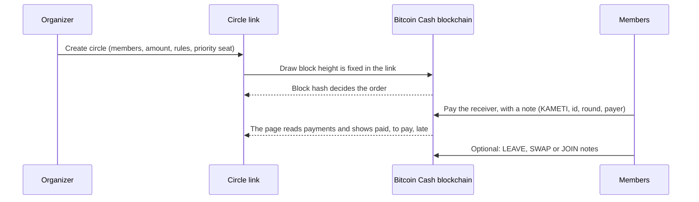
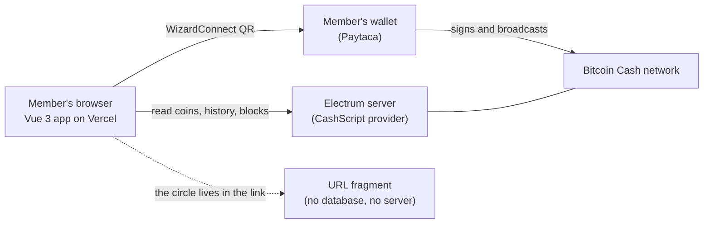

<div align="center">


# Kameti.cash

### A kameti where nobody holds the money.

**Interest-free savings circles on Bitcoin Cash. No custody, no fees, public proof.**

[Live app](https://kameti-blaze.vercel.app/) · [Presentation](TODO) · [Video](TODO) · [Example circle](TODO)

</div>

> Built for **BCH BLAZE 2026** (Mainnet track). Wallet connection: **WizardConnect**. Payments: real Bitcoin Cash mainnet transactions.

---

## Pre-existing work, declared

This project was **started on 20 Oct 2026, before the hackathon began (14 Nov 2026)**. Everything is declared here so the judges can see what was already built and what is new.

| | Link |
|---|---|
| Old repository (frozen on 13 Nov) | https://github.com/Hajrajadoon/kameti-v1 |
| Demo from before the hackathon | https://kameti-v1.vercel.app/ |
| New repository (this one) | https://github.com/Hajrajadoon/kameti-blaze |
| Boundary in the git history | tags `pre-hackathon-v1` and `pre-hackathon-final` |

This repository was created by cloning the old one, so **its history includes every earlier commit**. Commits dated 14 Nov 2026 or later are new work.

**Built before the hackathon (20 Oct to 13 Nov):** the core logic and a plain first interface.
- Create a circle: members, amount, period (days, weeks, months), first-week payment window
- Priority seat, and a payout order drawn from a future block hash
- WizardConnect wallet connection and the "you are connected as ..." wallet guard
- Real mainnet payments signed in the user's wallet, with an on-chain note, plus payment tracking from the blockchain
- Leave, swap and join through on-chain notes
- Reminders, a calendar file and a balance check

**New during the hackathon (14 Nov onward):**
- A complete redesign (Midnight and Mint theme) and a landing page: how it works, comparison, risks, FAQ
- A 3-step create flow, the **"I need the first turn"** switch and **"Use my connected wallet as Member 1"**
- The **group agreement**: ready-made rules plus a note, stored with the circle and counted in the circle id
- A redesigned circle page: identity card, round cards with progress, named paid and to-pay chips, collapsible details
- Opening a circle from a pasted link, a copy-link button, mobile layout and accessibility work
- A real mainnet example circle, this README, the presentation and the video

---

## Table of contents

[The problem](#the-problem) · [The solution](#the-solution) · [How it works](#how-it-works) · [Features](#features) · [Bitcoin Cash usage](#bitcoin-cash-usage) · [Architecture](#architecture) · [The draw](#the-draw) · [Seat changes](#seat-changes) · [Group agreement](#group-agreement) · [Security](#security) · [Honest limits](#honest-limits) · [Design principles](#design-principles) · [Tech stack](#tech-stack) · [Project structure](#project-structure) · [Run it locally](#run-it-locally) · [Mainnet proof](#mainnet-proof) · [Roadmap](#roadmap)

---

## The problem

A kameti (also called a committee, chama, susu or tanda) is how hundreds of millions of people save together. Every month each member puts in the same amount, and one member takes the whole pot, until everyone has had a turn.

It runs on trust, and it breaks in familiar ways:
- One person **holds everyone's money**. If they disappear, there is no recourse.
- The record of who paid lives in a **notebook** or a memory.
- The **order** is a paper draw or the organiser's decision, and people argue about it.
- Members cannot easily prove they paid.

## The solution

Kameti.cash removes the holder. **Each member pays the round's receiver directly from their own wallet**, in the first days of the round, so the receiver gets the whole amount at once. Every payment carries a small public note, so the page can read the blockchain and show **who has paid and who is late**. The order comes from the hash of a future Bitcoin Cash block, or from a priority seat the group agrees for someone with an urgent need.

There is **no account, no server and no database**: the circle lives inside its share link.

## How it works

1. **Create the circle.** Names and wallet addresses, the amount, the period and the payment window. Tick "I need the first turn" if you need the money first. Write a group agreement.
2. **Draw the order.** The block hash at a height fixed in the link decides everyone except the priority seat. Anyone can repeat the draw.
3. **Pay the receiver.** Each member opens the same link, connects their wallet with WizardConnect, and approves a payment to that round's receiver.
4. **See the proof.** Payments carry a note (circle id, round, payer). The page finds them on the blockchain and marks each member paid, to pay or late.



## Features

**For a circle**
- 3 to 20 members, any period (days, weeks, months), a first-week payment window so the receiver gets the whole amount at once
- **Priority seat** for an urgent need, agreed by the group in advance
- **Blockchain draw** that nobody can control, with a "verify it yourself" panel
- **Group agreement**: ready-made rules (notify before missing a payment, heir continues, group decides lateness, trusted members only) plus a note. "No seat selling" and "no interest or fees" are always included
- **Seat changes**: leave and join before the second round, and swap seats when both members approve

**For a member**
- The app recognises you from the connected wallet ("Connected as ..."), and you can only act as that wallet
- "What you owe" card, the next payment, days left, a wallet balance check and a calendar file with reminders
- Pay buttons that open only when a round's window opens

**For everyone**
- Anyone with the link can look at a circle without a wallet ("Preview as")
- A comparison with the traditional kameti, a risks section and an FAQ
- Works on phones

## Bitcoin Cash usage

| What | How |
|---|---|
| Wallet connection | **WizardConnect** (`@paytaca/wizardconnect-vue`): QR code, the wallet signs and broadcasts |
| Payments | Real **mainnet** transactions to the round's receiver, built with CashScript's `TransactionBuilder` and `@bitauth/libauth` |
| Payment tracking | An `OP_RETURN` note in every payment, read back from the receiver's history over Electrum |
| The draw | The hash of a block header, read through the Electrum provider |
| Seat changes | `OP_RETURN` notes posted from the member's own address |

### Note formats

All notes are `OP_RETURN` outputs. `id` is the circle id (below).

| Action | Note chunks | Posted by |
|---|---|---|
| Payment | `KAMETI`, `id`, `round`, `payerNumber` | the payer, to the receiver |
| Leave | `KAMETI`, `id`, `LEAVE`, `memberNumber` | that member, from their own address |
| Swap | `KAMETI`, `id`, `SWAP`, `fromNumber`, `toNumber` | the `from` member; it applies when both members have posted |
| Join | `KAMETI`, `id`, `JOIN`, `name`, `address` | the new member |

**Circle id:** the first 8 hex characters of SHA-256 over the sorted member addresses, amount, start date, period, draw block, priority address, payment window and the agreement rules and note. If anyone changes a rule, the id changes, and members who compare ids notice.

## Architecture



There is **no backend and no database**. The page reads the blockchain directly, and every state it shows (draw, payments, seat changes) can be recomputed by anyone from public data and the link.

## The draw

- The link stores a block height. When the chain is 2 blocks past it, the app reads that block's header and computes its hash.
- The seed for each roll is `SHA-256("<blockHash>:<circleId>:<counter>")`. Numbers are taken with rejection sampling to avoid bias, and the members are shuffled with Fisher-Yates.
- A **priority seat** is placed first, and the draw orders everyone else.
- Nobody can predict a future block hash, and every member's browser gets the same result.
- An "instant demo draw" uses a block that already exists. It is labelled as unfair and is for demos only.

## Seat changes

- **Before the second round starts:** a member who has not paid or received can leave, and a new member can take an open seat, at the last position. A seat still empty after that is removed, so the circle shrinks.
- **Swaps:** two members who have not received yet and whose rounds have not started can swap if **both** post an agreement. Seats are never sold.
- A note only counts if its transaction spent coins from the acting member's address, which proves who posted it.

## Group agreement

The group writes its rules when creating the circle. They are stored in the circle and counted in the circle id, and every member sees them before paying. The app records the rules and shows defaults, but **cannot enforce them**. For questions about inheritance or obligations, ask a scholar or a lawyer.

## Security

- **No keys and no secrets in the app.** Payments are built in the browser and **signed inside the user's wallet**. There is no backend and no environment variable with credentials.
- A shared link is untrusted data: it is **fully validated** (addresses on the right network, amounts, dates, agreement) before it is used.
- The app finds who you are **only from the connected wallet**, and Pay buttons need a matching active member.
- **Safety cap** per payment (0.002 BCH), addresses are checked for the right prefix, and a round can only be paid once its window has opened.
- A developer-only test payment form exists locally and is **hidden on the live site**.
- `npm audit` reports 0 vulnerabilities.

## Honest limits

- **Nobody can force a member to pay.** The app makes late payments visible to the whole group. Only start a circle with people you know.
- The first receiver carries the most trust. Agree early seats openly.
- Amounts are in BCH, whose value changes. Stablecoin circles are on the roadmap.
- A wallet connection can drop (for example after a page reload), and the phone's clock must be set to automatic.
- Payments are final once approved in a wallet.
- The app is a prototype for a hackathon. Use small amounts first.

## Design principles

Interest-free by design: members pay equal shares, the receiver gets exactly what was paid, and there are no fees or charges. Seats are never sold. We are not religious scholars, so please ask yours about your own situation.

## Tech stack

Vue 3, Vite, `@paytaca/wizardconnect-vue`, `cashscript` (Electrum network provider and transaction builder), `@bitauth/libauth`, hosted on Vercel. Wallet tested: **Paytaca**.

## Project structure

```text
kameti-blaze/
├── index.html
├── vercel.json              security headers
├── public/                  favicon.svg, logo.svg
└── src/
    ├── main.js, App.vue, style.css
    ├── config.js            network and Electrum host
    ├── site.js              links used by the banner and landing page
    ├── store.js             shared wallet state
    ├── circle.js            validation, rounds, circle id, agreement rules
    ├── draw.js              block hash and the draw
    ├── chain.js             Electrum provider, wallet addresses and coins
    ├── payment.js           builds and signs payments through WizardConnect
    ├── tracking.js          reads payment notes from the blockchain
    ├── events.js            leave, swap and join notes
    ├── reminders.js         calendar file
    └── components/          Landing, CreateWizard, CircleView, AgreementCard,
                             EventsPanel, WalletConnect, SiteHeader, ProjectBanner
```

## Run it locally

```bash
npm install
npm run dev        # development server
npm run build      # production build
```

Network settings are in `src/config.js` (`NETWORK`, `ADDRESS_PREFIX`, optional `ELECTRUM_HOST`). The project is set to **mainnet**. For the test network, use `chipnet` and `bchtest`.

## Mainnet proof

Real mainnet payments made with this project during testing (look them up in any Bitcoin Cash block explorer):

- `69a462619bbb58020f1bb18faa0d40814049e892bd5104229ad40e053f05b770`
- `54719325ff63b253b65fe90fdf81a494111974ffc746e07be23cb2fb9f866867`
- `e8f6b4e71c619a50cebb3e38211e369f610a3146e6013a297739f78c89aa1eba`

The example circle link above contains the payments for a complete first round.

## Roadmap

Stablecoin circles (a circle in dollars, not in BCH), wallet-enforced rules (the direction the XO team described), more wallets, a refundable deposit option reviewed with scholars, and a directory of open circles.

---

**Community Choice (EMBER2026 tokens):** `bitcoincash:zzdq02x89gjyrg58j3mz4jr7r6r6uzlnag69rn2ews`

*Kameti.cash is a prototype. It does not guarantee that members pay. Use it with people you know, and start with small amounts.*